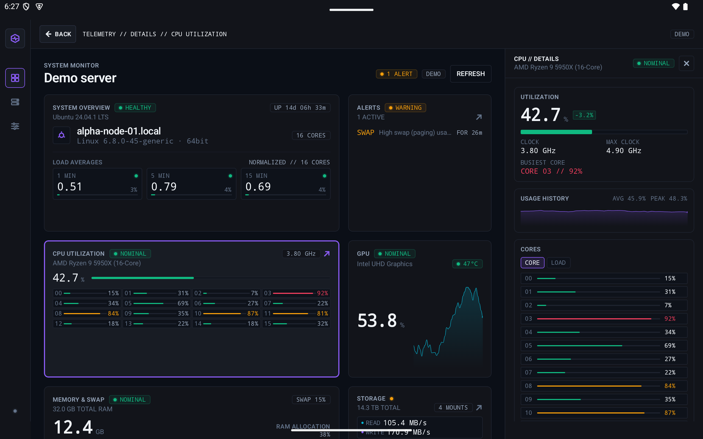
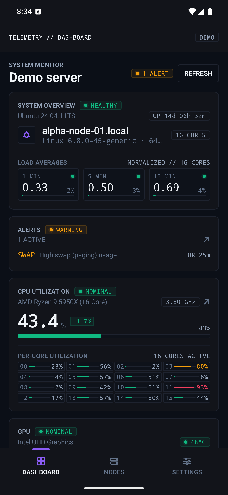

# Nascope

[](https://github.com/buszi/nascope/actions/workflows/ci.yml)
[](https://github.com/buszi/nascope/releases/latest)
[](LICENSE)


**Nascope** is a Kotlin Multiplatform telemetry and monitoring application engineered for systems engineers, homelab operators, and infrastructure architects. It targets **Android** and **Desktop (JVM)** with a unified UI built with **Compose Multiplatform** and **Material 3**.


<p align="center">
  
</p>

Live telemetry for your NAS or home server, on your phone, tablet and desktop. Nascope reads the REST API of [Glances](https://github.com/nicolargo/glances) and turns it into a dashboard of "bricks" (CPU, memory, storage, network, sensors, containers, processes, alerts), each with a details screen. No account, no cloud, no telemetry: the app talks only to the servers you add (see [PRIVACY.md](PRIVACY.md)).

<p align="center">
  
</p>

## Features

- **Dashboard of bricks** that adapts to the screen: bottom navigation on phones, a sidebar and a details pane on tablets and desktops.
- **System overview, CPU** (per core), **memory and swap**, **GPU**, **storage** (mounts and per-disk I/O with IOPS and latency), **network** (per interface), **sensors** (temperatures, fans), **containers** (Docker), **processes** (and programs, grouped by name, with pinning) and Glances' own **alerts**.
- **Adapts to the server:** bricks that depend on an optional Glances plugin (GPU, alerts) are hidden when the server does not have it; the others show an "unavailable" state when their data cannot be read.
- **Several servers** ("nodes"), a connection check that tells you what failed (host, Glances, authentication), HTTP and HTTPS, optional basic authentication.
- **Demo mode** with moving sample data, to explore the app without a server.
- A configurable refresh interval; polling pauses while the app is in the background.

## What you need

A host running Glances in web server mode, reachable from the device. Glances 4 (API v4) and Glances 3 (API v3) are supported. For example with Docker:

```sh
docker run -d --restart="always" -p 61208:61208 -e GLANCES_OPT="-w" \
  -v /var/run/docker.sock:/var/run/docker.sock:ro --pid host nicolargo/glances:latest-full
```

Glances serves its API on port `61208` by default. See the [Glances documentation](https://glances.readthedocs.io/en/latest/docker.html) for options (a password, the host network, other plugins). Without access to the Docker socket, Glances has no container data and the containers brick shows as unavailable.

**Behind a reverse proxy** (Caddy, nginx, Traefik, ...): if Glances is published on its own host name over HTTPS, choose **HTTPS** in the connection editor, enter that host name and use port **`443`**, not `61208`. Glances has to be served at the root of its host name: the app has no field for a path prefix such as `/glances`.

## Install

Downloads are on the [Releases](https://github.com/buszi/nascope/releases) page, with a `SHA256SUMS` file to check them against. Nascope is not signed with a paid developer certificate, so macOS, Windows and Android ask you to confirm the first launch or install.

### macOS (Apple Silicon)

With [Homebrew](https://brew.sh):

```sh
brew install --cask buszi/tap/nascope
```

Or download `Nascope-<version>.dmg`, open it and drag **Nascope** to Applications. The app is not notarized, so the first launch is blocked: open **System Settings, Privacy & Security**, scroll down to the message about Nascope and click **Open Anyway** (macOS 15 and later; earlier versions offer **Open** in the right-click menu). From a terminal the same thing is:

```sh
xattr -dr com.apple.quarantine /Applications/Nascope.app
```

### Windows (x64)

Download `Nascope-<version>.msi` and run it. It installs for your user only, without an administrator prompt, and adds **Nascope** to the Start menu; a newer msi upgrades the installed version in place. Because the installer is not code signed, Windows SmartScreen may say **"Windows protected your PC"**: click **More info**, then **Run anyway**. Passwords are stored in the Windows Credential Manager.

### Linux (Debian, Ubuntu and derivatives, amd64)

Download `nascope_<version>-1_amd64.deb` and install it with apt, which also pulls in what it needs:

```sh
sudo apt install ./nascope_<version>-1_amd64.deb
```

**Nascope** then appears in the application menu; `sudo apt remove nascope` removes it. Passwords are stored through the Secret Service (GNOME Keyring, KWallet); without one, a password lasts for the session only and the editor says so.

### Android

Download `Nascope-<version>.apk` on the device, open it and allow "Install unknown apps" for your browser or file manager when asked. Play Protect may warn about an app from an unknown developer: choose **Install anyway**. You can follow new releases with [Obtainium](https://obtainium.imranr.dev/) by adding this repository's URL.

If Android says **"App not installed"**, a differently signed build of Nascope is usually installed already, for example a debug build from a developer machine. Android checks every profile of the device, so look in a second user, a work profile and **Private space** as well, uninstall it there, and install again (the app's data goes with it). `adb install Nascope-<version>.apk` prints the exact reason (`INSTALL_FAILED_UPDATE_INCOMPATIBLE` for this case). If Play Protect offers to scan the app first, you can choose to install without scanning.

The APK is signed with this certificate (SHA-256), which you can compare with `apksigner verify --print-certs`:

```
37:B1:BD:A5:AD:60:02:0C:B0:8F:05:67:65:F4:02:F0:AC:0C:90:34:C8:AA:20:42:50:22:79:E3:76:00:CA:E2
```

## Security notes

- **HTTP is allowed on purpose.** A Glances server on a home network is usually plain HTTP (an IP address or a `.local` name has no certificate), so the app does not block cleartext traffic. Prefer HTTPS whenever the server offers it, and do not use HTTP over the internet: the Glances password travels in clear text.
- **Passwords are stored securely:** in the Android Keystore (encrypted, excluded from Android backups) and in the OS keyring on desktop (macOS Keychain, Windows Credential Manager, Linux Secret Service). Without a keyring the password lives in memory for the session only, and the editor tells you. A server restored from a backup or moved to another device has no password there: the app shows "NO PASSWORD" and asks for it again.
- **HTTPS certificates are validated** with the system's trust store. When a server's certificate is not trusted (self-signed, a private authority, expired), the connection test shows its SHA-256 fingerprint and asks whether to trust it; compare the fingerprint with the one your NAS or reverse proxy shows before you accept. A trusted certificate applies to that server's address only, and is trusted in addition to the system's: if the server later presents a different certificate that the system does not trust either, the app says so ("UNTRUSTED CERT") and asks again instead of connecting. A certificate from a public authority that names another host than the one you entered (e.g. reached by IP) is still rejected with a TLS error.
- **Redirects are not followed**, so credentials cannot be sent to another host.

## License

Apache License 2.0, see [LICENSE](LICENSE). Third-party libraries and their licenses: [THIRD_PARTY.md](THIRD_PARTY.md). Changes: [CHANGELOG.md](CHANGELOG.md).

---

# Development

---

## Architecture & Module Structure

The project uses Gradle type-safe project accessors and custom convention plugins under `build-logic`:

```
nascope/
├── build-logic/convention/       # Gradle convention plugins
│   └── plugins:
│       ├── plugins.kmp.library          # Multiplatform library setup
│       ├── plugins.kmp.compose          # Compose Multiplatform dependencies & compiler
│       ├── plugins.android.application  # Android application conventions
│       └── plugins.desktop.application  # Desktop JVM application conventions
├── domain-model/                 # Shared domain models (plain Kotlin, no dependencies)
│   └── src/commonMain/kotlin/io/buszi/nascope/domain/model/
├── domain/                       # Use cases (connection management)
│   └── src/commonMain/kotlin/io/buszi/nascope/domain/connection/
├── network/                      # Glances HTTP access (Ktor + OkHttp), connection client
│   └── src/{commonMain,androidMain,jvmMain}/kotlin/io/buszi/nascope/network/
├── storage/                      # Profile & preference stores (DataStore), secret store (Keystore / OS keyring)
│   └── src/{commonMain,androidMain,jvmMain}/kotlin/io/buszi/nascope/storage/
├── test-utils/                   # Shared JVM test helpers (TestCoroutineRule, Turbine extensions)
├── resources/                    # Common Compose Multiplatform assets & resources
│   └── src/commonMain/composeResources/
├── shared/                       # Core shared business logic & UI components
│   ├── src/commonMain/kotlin/
│   │   └── io/buszi/nascope/
│   │       ├── di/               # Koin root module + initNascope() (Koin + Napier startup)
│   │       ├── App.kt            # Root composable & Navigation 3 scaffold entrypoint
│   │       ├── ui/common/theme/  # Obsidian Telemetry Design System
│   │       ├── ui/common/components/  # Reusable UI primitives
│   │       ├── ui/root/          # Root gate: loading / setup flow / main scaffold
│   │       ├── ui/nodes/         # Stored servers: switch, edit, delete, demo mode
│   │       ├── ui/connection/    # Connection editor: add / edit a server with a live test
│   │       ├── ui/setup/         # Welcome & connection setup flow (outside the scaffold)
│   │       ├── ui/navigation/    # Adaptive Navigation 3 scaffold, routes & multi-pane scene strategy
│   │       ├── ui/dashboard/     # Modular telemetry dashboard & brick widgets
│   │       ├── ui/details/       # Brick detail inspector / drill-down screen
│   │       ├── ui/nodes/         # Cluster node management screen
│   │       └── ui/settings/      # Application settings screen
│   ├── src/androidMain/          # Android-specific implementations
│   └── src/jvmMain/              # JVM-specific implementations
├── androidApp/                   # Android entry point (NascopeApplication, MainActivity)
├── desktopApp/                   # Desktop JVM entry point (main.kt)
└── docs/                         # Developer documentation (CONVENTIONS.md)
```

---

## Obsidian Telemetry Design System

The application theme is located in [`io.buszi.nascope.ui.common.theme`](./shared/src/commonMain/kotlin/io/buszi/nascope/ui/common/theme) and is modeled after the **Obsidian Telemetry** design specification (OLED-optimized, low-light, high-contrast, technical instrument aesthetic).

### Theme Accessor
Theme tokens are exposed via `AppTheme` within any `@Composable`:

```kotlin
AppTheme {
    // Access colors, typography, shapes, spacing, and dimensions
    val bg = AppTheme.colors.canvasBackground
    val metricStyle = AppTheme.typography.metricDisplay
    val cardShape = AppTheme.shapes.lg
    val pad = AppTheme.spacing.spaceLg
}
```

### Theme Components

| File | Responsibilities & Tokens |
| :--- | :--- |
| **[`AppTheme.kt`](./shared/src/commonMain/kotlin/io/buszi/nascope/ui/common/theme/AppTheme.kt)** | Entry composable `AppTheme(...)` providing `CompositionLocalProvider` for all token groups; `object AppTheme` for static, ergonomic token access (`colors`, `colorScheme`, `typography`, `materialTypography`, `shapes`, `materialShapes`, `spacing`, `dimensions`, `platform`, `windowWidthClass`). |
| **[`Colors.kt`](./shared/src/commonMain/kotlin/io/buszi/nascope/ui/common/theme/Colors.kt)** | • **`DarkColorScheme`**: Full Material 3 dark color scheme mapping.<br>• **`AppColors`**:<br>&nbsp;&nbsp;- *Base / Surfaces*: `canvasBackground` (`#0B0F17`), `subSurface` (`#12141A`), `elevatedOverlay` (`#181C24`), `activeHoverRowFill` (`#1E232F40`), `inputBackground` (`#0E121A`).<br>&nbsp;&nbsp;- *Borders*: `baseBorder` (`#1E232F`), `subtleDivider` (`#171B26`), `focusHighlight` (`#384259`), `elevatedBorder` (`#282E3E`).<br>&nbsp;&nbsp;- *Telemetry*: `operational` (`#10B981`) + halo, `degraded` (`#F59E0B`) + halo, `critical` (`#F43F5E`) + halo, `telemetryA` (`#8B5CF6` core pipelines), `telemetryB` (`#06B6D4` network I/O).<br>&nbsp;&nbsp;- *Text Stack*: `textPrimary` (`#F1F5F9`), `textSecondary` (`#94A3B8`), `textMuted` (`#64748B`), `textDisabled` (`#334155`).<br>&nbsp;&nbsp;- *Badges & Buttons*: `healthyBadgeBackground` / `border`, `warningBadgeBackground` / `border`, `criticalBadgeBackground` / `border`, `buttonPrimary`, `buttonPrimaryHover` (`#7C3AED`). |
| **[`Typography.kt`](./shared/src/commonMain/kotlin/io/buszi/nascope/ui/common/theme/Typography.kt)** | • **Dual-Type Strategy**:<br>&nbsp;&nbsp;- **Inter** (`interFontFamily`): `headlineXl` (36sp), `headlineXlMobile` (28sp), `headlineLg` (24sp), `headlineSm` (18sp), `bodyLg` (15sp), `bodyMd` (14sp), `bodySm` (12sp), `labelUi` (11sp with positive tracking `0.04em`).<br>&nbsp;&nbsp;- **JetBrains Mono** (`monoFontFamily`): `metricDisplay` (32sp), `metricMd` (20sp), `codeBase` (13sp), `labelCode` (11sp with `0.02em` tracking). All telemetry styles use **tabular numerals** (`fontFeatureSettings = "tnum"`).<br>• Fully mapped to Material 3 `Typography`. |
| **[`Shapes.kt`](./shared/src/commonMain/kotlin/io/buszi/nascope/ui/common/theme/Shapes.kt)** | Tight technical radiuses: `sm` (2dp), `base` (4dp), `md` (6dp), `lg` (8dp), `xl` (12dp), `full` (CircleShape / 9999px for status dots and badges). Also configures Material 3 `Shapes`. |
| **[`Spacing.kt`](./shared/src/commonMain/kotlin/io/buszi/nascope/ui/common/theme/Spacing.kt)** | • **`AppSpacing`**: Micro & structural cadence (`space2xs` = 2dp, `spaceXs` = 4dp, `spaceSm` = 8dp, `spaceMd` = 12dp, `spaceLg` = 16dp, `spaceXl` = 24dp, `space2xl` = 32dp), margins, and gutters.<br>• **`AppDimensions`**: Hairline border (1dp), focus ring (2dp), status dot (6dp), button heights (32dp dense / 36dp regular), input height (32dp), switch track (32 x 18dp) and thumb (12dp), minimum touch target (48dp, applied on Compact windows), setup panel max width (480dp), node switcher menu width (280dp), table header (28dp), sidebar desktop (240dp), sidebar tablet (56dp), top bar height (52dp), bottom bar height (60dp), detail inspector width (360dp), log drawer (320dp), command palette width (580dp). |

---

## Application Architecture & Concepts

### Glances Telemetry Backend
Nascope connects to hosts running the [Glances](https://github.com/nicolargo/glances) monitoring service via its REST API (default port `61208`).
- **Connection Lifecycle**: First-launch onboarding captures base URL, port, protocol, and optional authentication secret. A pre-flight handshake validates DNS resolution, HTTP status, and Glances API status before entering the live dashboard.
- **Telemetry Collection**: One shared polling loop per Glances plugin in `:domain`, paced by a global refresh interval setting (fast plugins at the setting, slower ones at 5x, at most every 30 s) and paused while the app is in the background. A failed poll keeps the last value as stale before the brick goes offline. Charts use in-memory history (60 samples).
- **Demo Mode**: A built-in demo source produces moving values without a server, so the app can be explored and tested without a NAS.

### Adaptivity & Screen Form Factor Strategy
Nascope is designed as a premier showcase of Compose Multiplatform adaptivity, presenting an optimal layout across all screen factors without platform-branching UI logic:
- **Mobile (< 768dp)**: 4-column adaptive layout, 16dp margins, 12dp gutters. Sparkline cards stack into single columns; complex tables transform into swipeable cards with sticky left-most node identifiers.
- **Tablet (768dp - 1279dp)**: 8-column layout, 24dp margins, 16dp gutters. Sidebars collapse to a 56dp icon rail; metric panels form 2x2 grids.
- **Desktop (>= 1280dp)**: 12-column fluid grid, 32dp margins, 20dp gutters. Primary canvas features a split workbench layout: 240dp fixed utility sidebar, scalable telemetry workspace, and an optional 320dp live log/event drawer.

### Composable "Bricks" Dashboard
The dashboard is conceived as a modular surface built from independent, reusable "bricks" (widgets):
- **Encapsulated Scope**: Each brick (System, CPU Matrix, Memory & Swap, Storage Pools, Network I/O, Sensors/Thermals, Containers, Process List) owns its rendering, loading state, visual thresholds, and error fallbacks.
- **Fluid Grid Spans**: Bricks define minimum and preferred column spans to naturally wrap and reflow across window breakpoints.
- **User Customization**: Users will be able to customize their telemetry cockpit by toggling visibility, reordering widgets, or selecting preset layouts (e.g., Storage Focus, Compute Focus, Minimalist).

### Platform Extensions
Shared core features are augmented with desktop and mobile platform capabilities:
- **Desktop (JVM)**: Minimalist system tray status indicator displaying an operational health dot, hover metrics tooltip, and global shortcut overlay (Command Palette via `Cmd/Ctrl + K`).
- **Android**: Edge-to-edge transparent system bars and optional foreground telemetry alert notifications.

---

## Context & Guidelines for AI Agents

**Read [`docs/CONVENTIONS.md`](./docs/CONVENTIONS.md) before writing any code.** It covers project layout, design token usage, composable API shape, previews, animation/performance rules, Kotlin style, and the per-task workflow (showcase update → build verification → `PLAN.md` checkbox). Do not create git commits.

The essentials:
- Take every color, font, shape, and spacing value from `AppTheme`. Never hardcode hex, `dp`, or `sp` values.
- Put one public composable per file under `ui.common.components/<group>/`, each with its own `private @Preview`.

---

## Build & Run Commands

- **Build all targets**:
  ```bash
  ./gradlew assemble
  ```
- **Run Desktop App**:
  ```bash
  ./gradlew :desktopApp:run
  # Or with hot reload:
  ./gradlew :desktopApp:hotRun --auto
  ```
- **Build Android App**:
  ```bash
  ./gradlew :androidApp:assembleDebug
  ```
- **Package the Desktop App** (builds the installer of the OS you are on: `.dmg` on macOS, `.msi` on Windows,
  `.deb` on Linux; jpackage cannot cross-compile, see `docs/release.md`):
  ```bash
  ./gradlew :desktopApp:packageReleaseDistributionForCurrentOS
  # Output: desktopApp/build/compose/binaries/main-release/<dmg|msi|deb>/
  ```
- **Run Tests**:
  ```bash
  ./gradlew :shared:jvmTest
  ./gradlew :shared:testAndroidHostTest
  ```